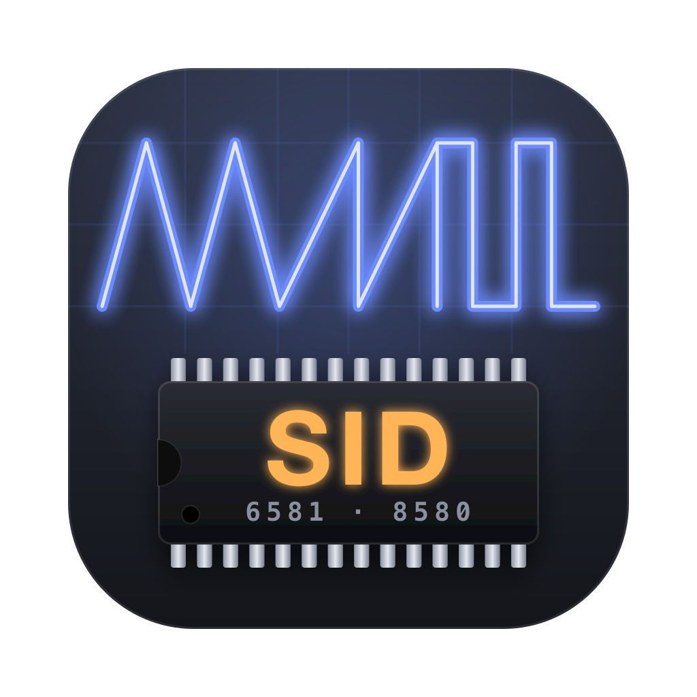

# SidControl

Editor and librarian for the **MIDIbox SID V2** (PIC18F core). It runs as a standalone Mac app, or as an AU or VST3 plugin.

It talks to the box with the official V2 SysEx protocol (`F0 00 00 7E 4B <device> ...`). The spec is
`apps/synthesizers/midibox_sid_v2/doc/mbsidv2_sysex_implementation.txt` in
[midibox/mios8](https://github.com/midibox/mios8).

## Build

Requires Xcode (or the command line tools) and CMake (`brew install cmake`).

```bash
git submodule update --init
cmake -B build -DCMAKE_BUILD_TYPE=Release
cmake --build build -j
ctest --test-dir build
```

Output is in `build/SidControl_artefacts/Release/`, in the `Standalone/`, `AU/` and `VST3/` folders.
To use the plugins, copy them to `~/Library/Audio/Plug-Ins/Components` (AU) or `~/Library/Audio/Plug-Ins/VST3`.

## Using it

1. Pick the **MIDI In** and **MIDI Out** your MIDIbox SID is connected to, then press **Test**.
   The status bar shows which SID cores answered.
2. **Live** (on by default): every edit is sent to the box's edit buffer as you make it.
3. **Get Edit Buffer** reads the patch that is currently playing. **Send Edit Buffer** sends the whole patch in the editor.
4. Librarian (left panel):
   - Choose the BankStick bank (A–H).
   - **Fetch Bank** reads all 128 patches from the box.
   - Double-click a patch to open it (and send it to the box).
   - **Store Here** writes the editor patch into the selected slot on the box.
   - **Write Bank** writes the whole list to the box.
   - **Open .syx** and **Save Bank** read and write bank files. The official preset banks open directly.
   - Right-click a patch for copy, paste, init and clear.
5. **Save Patch .syx** saves the current patch as an edit-buffer dump, so sending it to a box never overwrites a stored slot.

The plugin opens the MIDI ports itself, because many DAWs filter out SysEx. Everything is saved with
the DAW project, or in the app settings when you run it standalone.

## Status

| Engine   | Editor pages |
|----------|--------------|
| Lead     | Voices, Filter & Global, LFOs, Envelopes, Mod Matrix, Trigger Matrix, Wavetables, Knobs & Ext |
| Bassline | Bassline L/R (OSC1-3, accent, play mode, LFOs, envelope, sequencer settings), Sequences (step editor), Filter & Global, Knobs & Ext |
| Drum     | Instruments (16), Patterns (8 tracks: A, A accented, B per step), Filter & Global, Knobs & Ext |
| Multi    | Instruments (6, with LFOs, envelope, wavetable sequencer), shared Wavetable, Filter & Global, Knobs & Ext |
| Ensemble | Per SID core: patch, clock, options, analog outputs, filter calibration, 6 instruments (channel, split, transpose) |

Patches of every engine can be fetched, stored, sent and saved. Ensembles have their own
fetch, store, send and `.syx` buttons (the **Ensemble** button in the patch header).

Keyboard play-through: MIDI from the standalone app's "Active MIDI Inputs" or from the DAW track
goes to the SID. You can remap it to one channel with the **Keys** menu.

MIDI learn: right-click any knob, button or menu and choose **MIDI Learn**, then move a control on your
keyboard or controller. Mapped controls show a small amber dot, and their tooltip names the CC.
Mappings belong to one engine (the same knob can control a different parameter in Lead and in Drum)
or to the ensemble. Mapped CCs change the editor and are not passed through to the SID. Unmapped CCs
pass through as before. Mappings are saved with the app settings or the DAW project.

`sidcli` (built with the app) is a diagnostics tool: `list`, `scan`, `ping`, `get`, `getens`, `play`, `monitor`.

## Layout

- `Source/sid/`: plain C++ with no JUCE. Contains the patch model, SysEx codec, parameter tables and `.syx` files.
  The tests in `Tests/` cover this code.
- `Source/device/SidDevice`: MIDI ports, a request queue with timeouts, and rate-limited live parameter writes.
- `Source/model/Session`: the edit buffer, the bank, transfers, files and saved state.
- `Source/ui/`: the editor UI.

Developer aid: setting `SIDCONTROL_SNAPSHOT_DIR=/some/dir` makes the app render every editor page to PNG and quit.
You can also set `SIDCONTROL_SNAPSHOT_SYX` and `SIDCONTROL_SNAPSHOT_SLOT` to load a patch first.

## Credits

SidControl would not exist without **Thorsten Klose (TK.)** and the [MIDIbox](http://www.midibox.org) community.
The MIDIbox SID, its V2 firmware, the SysEx protocol, the sound engines and the preset patches are TK.'s work.
SidControl is only a remote control for them.

- The SysEx implementation follows TK.'s `mbsidv2_sysex_implementation.txt`.
- The parameter tables follow the firmware sources (`sid_patch.inc`, `sid_ens.inc` and others) in
  [midibox/mios8](https://github.com/midibox/mios8).
- `Source/sid/InitPatches.cpp` (the init patches) is generated from the firmware's `sid_preset_*.inc` files.
- `Source/sid/ParamNames.cpp` (parameter names) is generated from `mbsidv2_parameter_chart.txt`.

Those files are Copyright 1998–2007 Thorsten Klose (tk@midibox.org) and are "licensed for personal
non-commercial use only". SidControl is a free, non-commercial hobby project. Please don't use any of it commercially.

SidControl is built with [JUCE](https://juce.com).
The SammichSID hardware was designed by Wilba for the MIDIbox community.
